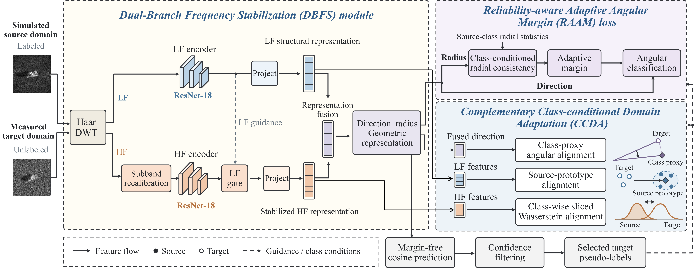

# Frequency-Stabilized Geometric Adaptation for Unsupervised Simulated-to-Measured SAR Target Recognition

PyTorch code for FSGA, organized from the supplied training script. This release uses ResNet-18 and slim MLPs (labeled **FSGA-Lite** in the source). Its correspondence to the manuscript’s main-result configuration remains to be confirmed.



## Installation

Please see [INSTALL.md](INSTALL.md).

## SAMPLE Dataset

SAMPLE contains 1,345 simulated–measured image pairs from ten vehicle categories. We use labeled simulated images and unlabeled measured training images for adaptation, and evaluate on the measured test set.

### Scenario I

| Category | Simulated training | Measured training | Measured testing | Total |
|:---|---:|---:|---:|---:|
| Depression angle | 14°–17° | 14°–16° | 17° | — |
| 2s1 | 174 | 116 | 58 | 348 |
| bmp2 | 107 | 55 | 52 | 214 |
| btr70 | 92 | 43 | 49 | 184 |
| m1 | 129 | 78 | 51 | 258 |
| m2 | 128 | 75 | 53 | 256 |
| m35 | 129 | 76 | 53 | 258 |
| m548 | 128 | 75 | 53 | 256 |
| m60 | 176 | 116 | 60 | 352 |
| t72 | 108 | 56 | 52 | 216 |
| zsu23 | 174 | 116 | 58 | 348 |
| **Total** | **1345** | **806** | **539** | **2690** |

### Scenario II

| Category | Simulated training | Measured training | Measured testing | Total |
|:---|---:|---:|---:|---:|
| Depression angle | 14°–17° | 16° | 17° | — |
| 2s1 | 174 | 50 | 58 | 282 |
| bmp2 | 107 | 55 | 52 | 214 |
| btr70 | 92 | 43 | 49 | 184 |
| m1 | 129 | 52 | 51 | 232 |
| m2 | 128 | 52 | 53 | 233 |
| m35 | 129 | 52 | 53 | 234 |
| m548 | 128 | 52 | 53 | 233 |
| m60 | 176 | 51 | 60 | 287 |
| t72 | 108 | 56 | 52 | 216 |
| zsu23 | 174 | 50 | 58 | 282 |
| **Total** | **1345** | **513** | **539** | **2397** |

### Scenario III

| Category | Simulated training | Measured training | Measured testing | Total |
|:---|---:|---:|---:|---:|
| Depression angle | 14°–16° | 16° | 17° | — |
| 2s1 | 116 | 50 | 58 | 224 |
| bmp2 | 55 | 55 | 52 | 162 |
| btr70 | 43 | 43 | 49 | 135 |
| m1 | 78 | 52 | 51 | 181 |
| m2 | 75 | 52 | 53 | 180 |
| m35 | 76 | 52 | 53 | 181 |
| m548 | 75 | 52 | 53 | 180 |
| m60 | 116 | 51 | 60 | 227 |
| t72 | 56 | 56 | 52 | 164 |
| zsu23 | 116 | 50 | 58 | 224 |
| **Total** | **806** | **513** | **539** | **1858** |

## Attributed Scattering Center of SAMPLE Dataset

The ASC data and corresponding imaging results were released by the [TFSNet authors](https://github.com/SAR-Images-Understanding-Yang/TFSNet). We provide a download mirror only and thank the authors for sharing these resources. Please cite [their paper](https://doi.org/10.1016/j.patcog.2026.113405) when using the data.

[Download ASC-SAMPLE (Baidu Netdisk)](https://pan.baidu.com/s/1UqBgMHgxBGqNqH0bcv5PaQ?pwd=JY10) · Extraction code: **JY10**

## Classification Results on the Three Scenarios

Manuscript results are mean ± standard deviation over five runs; F1 is macro-averaged. These values have not been reproduced with this packaged release.

| Scenario | PCC (%) | F1 (%) |
|:---:|---:|---:|
| I | 99.89 ± 0.25 | 99.89 ± 0.25 |
| II | 99.63 ± 0.57 | 99.65 ± 0.54 |
| III | 99.26 ± 0.13 | 99.26 ± 0.12 |

## Training

Run from the repository root; `--data-root` points to one scenario folder.

```bash
python tools/train.py --config configs/scenario_I/FSGA.yaml --data-root datasets2_sample_qpm/scenario_I
python tools/train.py --config configs/scenario_II/FSGA.yaml --data-root datasets2_sample_qpm/scenario_II
python tools/train.py --config configs/scenario_III/FSGA.yaml --data-root datasets2_sample_qpm/scenario_III
```

The supplied script selects the best checkpoint by **test-set PCC** at every epoch. This behavior is preserved; see [implementation notes](docs/IMPLEMENTATION_NOTES.md).

## Testing and Visualization

```bash
python tools/visualize_results.py --config outputs/scenario_I/config.yaml --checkpoint outputs/scenario_I/best.pth --output-dir outputs/scenario_I/evaluation
```

Replace `scenario_I` with `scenario_II` or `scenario_III` for the other scenarios. Add `--tsne` to visualize test features. Use `tools/test.py` for metrics without plots.

## Notes

For questions, please contact [y10250172@mail.ecust.edu.cn](mailto:y10250172@mail.ecust.edu.cn).

Provisional citation:

```bibtex
@unpublished{yang2026fsga,
  author = {Ying Yang and Yuzhuo Chen and Xianghai Kong and Yuhan Xu and Haitao Zhao},
  title  = {Frequency-Stabilized Geometric Adaptation for Unsupervised Simulated-to-Measured {SAR} Target Recognition},
  note   = {Unpublished manuscript},
  year   = {2026}
}
```
